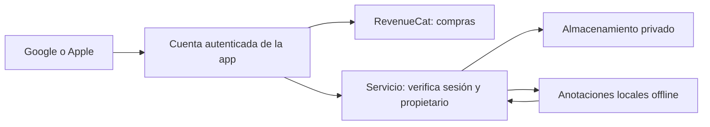

# Cuenta y respaldo de anotaciones — investigación, 2026-10-09

Solo investigación. No se modificó el almacenamiento de anotaciones, la autenticación o RevenueCat; no se crearon buckets, tablas ni servicios.

## Conclusión

Es viable respaldar anotaciones y recuperarlas entre Android e iOS. La propuesta es usar una cuenta autenticada propia, con acceso mediante Google o Apple, y asociar esa identidad con las compras de RevenueCat. Iniciar sesión con Google/Apple sería un paso explícito; no equivale a leer automáticamente la cuenta que está comprando en Play Store/App Store.

RevenueCat identifica compras mediante App User IDs y permite usar un ID propio entre plataformas. Restaurar compras recupera transacciones de la tienda; esa operación no establece por sí sola una sesión autenticada para nuestros archivos privados. Véanse [identidad](https://www.revenuecat.com/docs/customers/identifying-customers) y [restauración](https://www.revenuecat.com/docs/getting-started/restoring-purchases).

## Situación actual comprobada en el proyecto

- La app genera un identificador `coro_...` y lo conserva en Hive para RevenueCat.
- En iOS intenta conservarlo en Keychain con sincronización de iCloud.
- Vincular dispositivos permite introducir un ID y llamar a `Purchases.logIn`.
- No se encontró un inicio de sesión autenticado de usuario en la app.

Por tanto, no se debe conceder acceso a anotaciones privadas por conocer ese ID. La identidad de almacenamiento debe proceder de una sesión verificada y mantenerse estable aunque se restaure, transfiera o cambie una suscripción.

## Diseño propuesto, pendiente de aprobación

Supabase Auth admite [Google](https://supabase.com/docs/guides/auth/social-login/auth-google) y [Apple](https://supabase.com/docs/guides/auth/social-login/auth-apple). Un UUID interno serviría como propietario estable. Se tendría que definir cómo enlazar cuentas de ambos proveedores sin unir personas distintas y cómo asociar los IDs anteriores de RevenueCat sin afectar compras.

### Almacenamiento

| Opción | Propuesta | Trabajo necesario |
| --- | --- | --- |
| Supabase Storage | Bucket privado con reglas por propietario | Auth, políticas RLS y gestión de versiones/conflictos |
| Cloudflare R2 | Bucket privado separado del repertorio | Auth y Worker que verifique sesión, propietario y permisos en cada operación |

Supabase permite controlar buckets privados mediante JWT y RLS: [documentación](https://supabase.com/docs/guides/storage/buckets/fundamentals). R2 es privado de forma predeterminada y puede usarse desde Workers: [buckets](https://developers.cloudflare.com/r2/buckets/create-buckets/) y [Workers](https://developers.cloudflare.com/r2/api/workers/workers-api-usage/).

Mi recomendación inicial es evaluar Supabase Auth + Storage por tener menos piezas de autorización. Auth + R2 también encaja si se decide centralizar archivos en Cloudflare. La decisión requiere estimar usuarios, tamaño y frecuencia de sincronización; no se calculó ni contrató capacidad.

## Condiciones antes de implementar

- Mantener dibujo y guardado local disponibles desde el primer inicio sin internet ni cuenta. Sincronizar después, con sesión y conexión.
- Recuperar los datos ligados a los IDs antiguos de los 39 cantos antes de importarlos al respaldo. No deduplicar por título.
- Separar propiedad de notas y estado premium: una transferencia de compra no debe transferir notas privadas.
- Conservar revisiones por canto/página, bajas y copias recuperables; resolver cambios simultáneos sin sobrescribir silenciosamente.
- Aislar usuarios en dispositivos compartidos y ofrecer desconexión, exportación y eliminación de respaldo.
- Distinguir cambio de versión del PDF de identidad de obra: las notas pueden requerir revisión si cambia la paginación.

No se recomienda crear un bucket todavía: primero deben definirse autenticación, migración y reglas de conflicto. Estas condiciones son propuestas de diseño, no funciones existentes.
